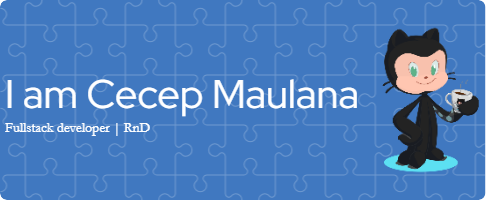

    <!-- Kamu bisa menggunakan banner image di sini jika ada -->
    <!--  -->
    
    <h1>Hi there, I'm Cecep Maulana 👋</h1>
    <h3>Full-Stack Software Engineer | Web & IoT Enthusiast</h3>
    
<i>"Crafting robust solutions through clean code and modern architecture."</i>

    

---

### 🧑🏻‍💻 About Me

Berbekal pengalaman komprehensif dalam rekayasa perangkat lunak, saya berdedikasi untuk menciptakan aplikasi yang skalabel dan efisien. Fokus saya ada pada pengembangan web <i>end-to-end</i> dan pengolahan data, dengan standar tinggi pada penulisan kode yang bersih.

- 🚀 Saat ini berfokus pada **Web Development** dan **Pengolahan Data**.
- 💡 Berpengalaman membangun arsitektur aplikasi menggunakan ekosistem **Laravel** (termasuk Lumen) dan **Vue.js** (berkolaborasi dengan Vite / Laravel Mix).
- ⚙️ Memiliki ketertarikan dan pengalaman dalam mengembangkan integrasi **Sistem IoT**.
- 🌱 Terus bereksplorasi dengan standar industri terkini dan optimasi performa *database*.
- 📫 Hubungi saya melalui LinkedIn untuk kolaborasi atau diskusi teknologi!

---

### ⚔️ Tech Stack

<b>Front-end Development</b>

 

    

<b>Back-end Development</b>

 

    

<b>Databases</b>

 

    

<b>Tools & Infrastructure</b>

 

    

---

### 📊 GitHub Analytics

    

 

    
    

<!-- 

    

 
-->
